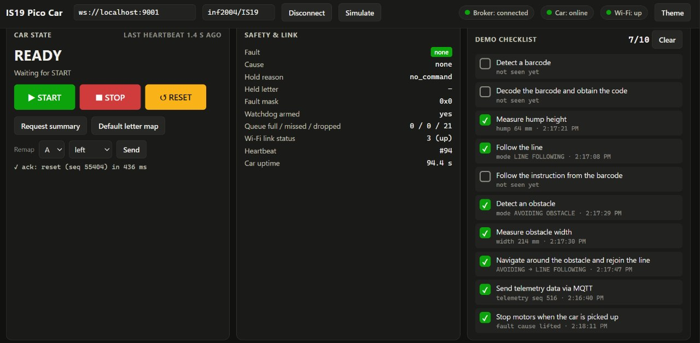
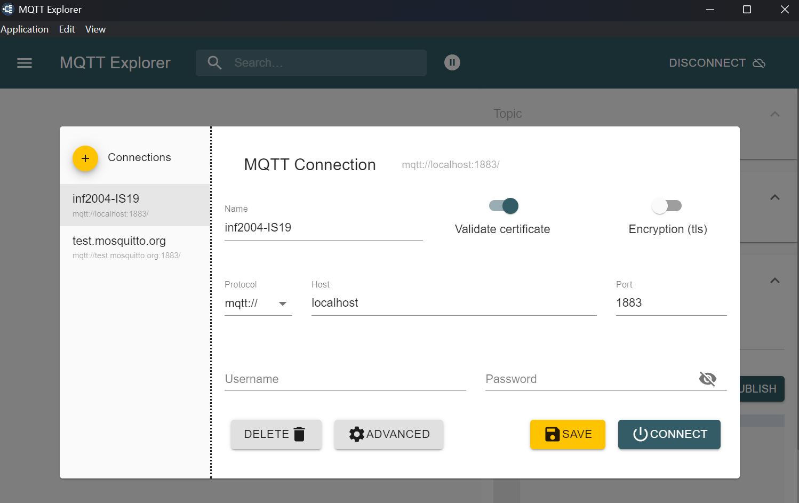

# IS19 PicoCar (INF2004)

Firmware for team IS19's autonomous line-following car: a Raspberry Pi Pico W on a Cytron Robo Pico, running micro T-Kernel 3.0 on both cores.
It is built from the course template; the template's original guide is at the end of this file.

The car follows the line, reads Code 39 barcodes, crosses humps, scans and goes round obstacles, and stops when it is picked up.
It sends live telemetry over Wi-Fi to an MQTT broker. A browser dashboard can watch the car and START, STOP or RESET it.

| Where | What |
|---|---|
| [`TEAM.md`](TEAM.md) | Owners, pins, peripherals, tasks, interfaces, object and RAM budget, template exceptions |
| [`Changes.md`](Changes.md) | Tuning and fixes made on the track (speeds, scan, lift detection, timer fix) |
| [`MQTT_SETUP_GUIDE.md`](MQTT_SETUP_GUIDE.md) | Full MQTT set-up from scratch, topics, commands and troubleshooting |
| [`dashboard/`](dashboard/) | `IS19_car_dashboard.html` (browser dashboard) and `mosquitto_is19.conf` (broker config) |
| [`docs/images/`](docs/images/) | Screenshots used in this README |
| [`docs/decisions.md`](docs/decisions.md) | Every design choice and change (D-numbers) and the open questions |
| [`docs/minimum_bit.md`](docs/minimum_bit.md) | Change requirement 1 (minimum-bit data): representation table, sizes, test evidence |
| [`app_program/app_config.h`](app_program/app_config.h) | Every tunable value with its source |
| `app_program/subsystemN/`, `navigation/`, `common/` | The code, one folder per owner |
| `testing/` | Test definitions and results; [`testing/host/`](testing/host/Makefile) has the host unit tests |
| [`testing/TRACEABILITY.md`](testing/TRACEABILITY.md) | Every requirement traced to its design, code and tests |

> Values in `app_config.h` marked `UNVALIDATED` are starting values that have not been measured on the car.
> Check them with the manual tests in `testing/*/TEST_LOG.md` before relying on them.

---

## Demo quick start (what we run on demo day)

```
 Pico W car  --(Wi-Fi, MQTT, port 1883)-->  Mosquitto on the laptop  --(WebSocket, port 9001)-->  Dashboard in the browser
             <----------------- commands: start / stop / reset / remap / summary -----------------------  buttons
```

Everything runs on the same **phone hotspot**.

> ⚠️ **SIT-Wi-Fi does not work.** Connect both the laptop and the car to a **mobile hotspot**.
> On an iPhone, turn on **Maximise Compatibility**: the Pico W only sees 2.4 GHz networks.

### Step 0 – One-time checks

- The toolchain and the Pico SDK are set up (section 1 below), **including the `lib/lwip` submodule**:
  ```sh
  ls $PICO_SDK_PATH/lib/lwip/src/core/init.c   # must exist
  # if not: cd ~/pico/pico-sdk && git submodule update --init lib/lwip
  ```
- Mosquitto is installed on Windows in `C:\Program Files\mosquitto` (<https://mosquitto.org/download/>).
- Copy `dashboard/mosquitto_is19.conf` to `C:\mosquitto\mosquitto_is19.conf`. It contains:
  ```
  # Car connects here (plain MQTT)
  listener 1883 0.0.0.0
  # Dashboard (browser) connects here (MQTT over WebSockets)
  listener 9001
  protocol websockets
  allow_anonymous true
  ```
- MQTT Explorer is installed (<https://mqtt-explorer.com>). This is optional; the dashboard shows everything too.

### Step 1 – Connect the laptop to the hotspot and find its IP

1. Turn on the phone hotspot and connect the laptop to it.
2. In PowerShell:
   ```powershell
   ipconfig
   ```
3. Under **Wireless LAN adapter Wi-Fi**, note the **IPv4 Address**. On an iPhone hotspot it is usually `172.20.10.x`.
   This is the broker IP the car connects to.

### Step 2 – Set the Wi-Fi and broker in `config/wifi_secrets.h`

Create the file **once** from the example. The example stays as it is, with placeholders, because it is committed to git:

```sh
cd ~/is19/INF2004_IS19-mainv4          # your clone of this repo
cp config/wifi_secrets.example.h config/wifi_secrets.h
nano config/wifi_secrets.h
```

Fill in **`config/wifi_secrets.h`**:

```c
#define WIFI_SSID         "<your hotspot name>"       /* 2.4 GHz, case-sensitive */
#define WIFI_PASSWORD     "<your hotspot password>"

/* Only used when built with MQTT=1 (also requires NET=lwip). */
#define MQTT_BROKER_IP    "172.20.10.4"               /* laptop IPv4 from Step 1 */
#define MQTT_BROKER_PORT  1883
#define MQTT_CLIENT_ID    "inf2004-IS19"              /* unique: never the template's "mtk3smp-pico" */
#define MQTT_TOPIC        "mtk3smp-pico/heartbeat"    /* template topic, not used by IS19 */
```

> 🔒 **Never put a real password in `wifi_secrets.example.h`, and never commit `wifi_secrets.h`.**
> `wifi_secrets.h` is in `.gitignore`. Check with `git status` before every push.
>
> If the laptop's IP changes (a new hotspot or a reconnect), update `MQTT_BROKER_IP`, then rebuild and reflash (Steps 3–4).

### Step 3 – Build the firmware (WSL)

```sh
cd ~/is19/INF2004_IS19-mainv4/build_make
code ..                                   # optional: open the project in VS Code
make clean
make -j8 NET=lwip MQTT=1
ls -l --time-style=+%H:%M *.uf2           # check the .uf2 time is "now"
explorer.exe .                            # open the build folder in Windows
```

The firmware file is **`build_make/mtk3pico_smp1_usb_cdc_wifi_lwip_mqtt.uf2`**.

### Step 4 – Flash the car

1. Hold **BOOTSEL** on the Pico W, plug in the USB cable, then release. A drive called **RPI-RP2** appears.
2. Drag `mtk3pico_smp1_usb_cdc_wifi_lwip_mqtt.uf2` onto **RPI-RP2**. The Pico reboots by itself.

### Step 5 – Start Mosquitto (PowerShell **as Administrator**)

```powershell
# 1. Stop the Mosquitto Windows service (it holds port 1883 with its default config)
Stop-Service mosquitto

# 2. One time only: let the car reach port 1883 through the firewall
New-NetFirewallRule -DisplayName "MQTT 1883" -Direction Inbound -Protocol TCP -LocalPort 1883 -Action Allow

# 3. Run Mosquitto with the IS19 config
cd "C:\Program Files\mosquitto"
.\mosquitto.exe -c C:\mosquitto\mosquitto_is19.conf -v
```

You should see:

```
Opening ipv4 listen socket on port 1883.
Opening websockets listen socket on port 9001.
```

Leave this window open. When the car joins, you'll see `New client connected from 172.20.10.x as inf2004-IS19`.

### Step 6 – Watch the car

**IS19 dashboard (recommended)**



**6.1 Connect the dashboard to the car**

1. Open `dashboard/IS19_car_dashboard.html` in Chrome or Edge.
2. In the top bar, set:
   - broker: `ws://localhost:9001`
   - topic root: `inf2004/IS19`
3. Click **Connect**. This links the dashboard to the car's telemetry through Mosquitto.
   Once connected, the button changes to **Disconnect**, as in the screenshot.
4. Check that the three indicators at the top right are **green**:

   | Indicator | Green means |
   |---|---|
   | **Broker: connected** | The dashboard reached Mosquitto on port 9001 |
   | **Car: online** | The car's heartbeat (`inf2004/IS19/status`) is arriving |
   | **Wi-Fi: up** | The car reports its own Wi-Fi/MQTT link is up |

   If it shows **Car: no data** or **Car: silent N s** instead, the car's heartbeat isn't arriving (online means a heartbeat within the last 3 s).
   Check `MQTT_BROKER_IP`, the hotspot and the firewall (Troubleshooting below).
5. The **CAR STATE** panel shows the current mode (e.g. **READY – Waiting for START**) and "Last heartbeat … ago".

**6.2 Control the car remotely: START, STOP, RESET**

You don't need to press the buttons on the car; the dashboard buttons do the same thing over MQTT.

| Button | What it does | Same as |
|---|---|---|
| **▶ START** | Starts a run from READY | GP20 button on the car |
| **■ STOP** | Stops the car at once and latches a STOP fault (brakes until RESET) | MQTT `stop` command |
| **↺ RESET** | Clears a fault or SAFE HOLD and returns to READY; then press START again | GP21 button on the car |

Each press is confirmed under the buttons, e.g. `✓ ack: reset (seq 55404) in 436 ms`.

The **Request summary** button asks the car for its run summary. The summary appears in the Summary panel and the event log.

**6.3 Map the barcode letters (Remap)**

Use this to change which action a barcode letter makes the car take at the next junction:

1. In the **Remap** row, choose the **letter** from the first dropdown (**A–Z**).
2. Choose the **action** from the second dropdown:

   | Action | Meaning at the next junction |
   |---|---|
   | `none` | The letter has no action |
   | `straight` | Go straight |
   | `left` | Turn left |
   | `right` | Turn right |
   | `uturn` | U-turn |

3. Click **Send**. The car replies with an ack (`✓ ack: remap …`). The new mapping takes effect within 1 s, with no reflashing.
4. **Default letter map** restores A = straight, B = left, C = right, D = U-turn.

**6.4 The other panels**

- **SAFETY & LINK:** fault, cause, hold reason, held letter, fault mask, watchdog, queue full / missed / dropped, Wi-Fi link status, heartbeat count and car uptime.
- **DEMO CHECKLIST:** ticks each of the 10 demo items automatically, with the value and time, as the car does it. **Clear** resets the list.
- **Charts, Barcodes, Obstacle profile, Event log:** further down the page. **Export** saves the event log as a `.txt` file.
- **Simulate** plays fake data, so you can try the dashboard without the car.

**MQTT Explorer (optional)**



Create a connection with these settings:

| Field | Value |
|---|---|
| Name | `inf2004-IS19` |
| Validate certificate | on (it has no effect without TLS) |
| Encryption (tls) | **off** |
| Protocol | `mqtt://` |
| Host | `localhost` |
| Port | `1883` |
| Username / Password | leave empty |

Press **Save**, then **Connect**. The car's messages appear under `inf2004/IS19/…`.

### Step 7 – Run

1. Place the car on the line and keep it **still for about 2 s** after power-on, so the IMU can calibrate.
2. Wait until the dashboard shows **READY** and all three indicators are green.
3. (Optional) Remap any barcode letters (6.3).
4. Press **▶ START** on the dashboard. The car's GP20 button also works.
5. To stop: press **■ STOP** on the dashboard, or **lift the car** (it latches a `lifted` fault and brakes).
6. To run again: press **↺ RESET**, then **▶ START**, both on the dashboard.

### Every-session checklist

1. ☐ Phone hotspot on (Maximise Compatibility); laptop connected to it. Not SIT-Wi-Fi.
2. ☐ `ipconfig` IPv4 = `MQTT_BROKER_IP` in `wifi_secrets.h`. If not: edit, rebuild, reflash.
3. ☐ Admin PowerShell: `Stop-Service mosquitto`, then run `mosquitto.exe -c C:\mosquitto\mosquitto_is19.conf -v`.
4. ☐ Dashboard: **Connect** to `ws://localhost:9001` (the button then reads **Disconnect**). MQTT Explorer on `localhost:1883` is optional.
5. ☐ Car powered and still. Mosquitto shows `New client connected … inf2004-IS19`.
6. ☐ Top right of the dashboard is green: **Broker: connected**, **Car: online**, **Wi-Fi: up**.
7. ☐ READY, then **▶ START** on the dashboard.

---

## MQTT topics and commands

All topics start with `inf2004/IS19/`.

| Topic | Direction | Content |
|---|---|---|
| `telemetry` | car → | 5 Hz: mode, wheel speeds, encoder counts, distance, line sensors, barcodes, hump, obstacle, IMU, turn rate |
| `status` | car → | 1 Hz heartbeat: mode, held letter, hold reason, Wi-Fi, fault, cause, fault mask, watchdog, queue stats |
| `event` | car → | Route log (barcode, turn, hump, obstacle, line search, safe hold, complete, no command, fault, `bc_fail`), obstacle profile, motion class, link, summary |
| `ack` | car → | Reply to each command, with its `seq` and `ok` |
| `cmd` | → car | Commands (below) |

Commands are flat JSON on `inf2004/IS19/cmd`. The dashboard buttons send them for you.

```json
{"seq":1,"cmd":"start"}
{"seq":2,"cmd":"stop"}
{"seq":3,"cmd":"reset"}
{"seq":4,"cmd":"summary"}
{"seq":5,"cmd":"remap","letter":"E","action":"left"}
{"seq":6,"cmd":"default_map"}
{"seq":7,"cmd":"broker","ip":"192.168.1.20","port":1883}
```

- `start` and `reset` act exactly like the car's GP20 and GP21 buttons.
- `stop` latches a STOP fault: the car brakes until RESET.
- `remap` actions are `none`, `straight`, `left`, `right` and `uturn`. The default map is A = straight, B = left, C = right, D = U-turn.
- `broker` is kept in RAM only. A reboot goes back to `MQTT_BROKER_IP` in `wifi_secrets.h`.

More detail is in [`MQTT_SETUP_GUIDE.md`](MQTT_SETUP_GUIDE.md).

---

## Troubleshooting

| Symptom | Likely cause | Fix |
|---|---|---|
| Build: `lwIP not found` / `core/init.c` missing | SDK `lib/lwip` submodule missing | `cd ~/pico/pico-sdk && git submodule update --init lib/lwip` |
| Build: `wifi_secrets.h: No such file` | Secrets file not created | Step 2 |
| Mosquitto: `Address already in use` / `Only one usage of each socket address` | Windows service still on 1883 | `Stop-Service mosquitto` in **admin** PowerShell |
| Car never appears in the Mosquitto log | Wrong `MQTT_BROKER_IP`, laptop on SIT-Wi-Fi, 5 GHz hotspot, or firewall | Steps 1, 2 and 5. Hotspot with Maximise Compatibility. |
| Dashboard won't connect | Mosquitto not started with the IS19 config (no port 9001) | Restart with `-c C:\mosquitto\mosquitto_is19.conf`; check "websockets … port 9001" |
| Dashboard connected but empty | Wrong topic root, or car not online yet | Topic root `inf2004/IS19`; wait for the heartbeat |
| Client connects and disconnects repeatedly | Two clients with the same `MQTT_CLIENT_ID` | Keep `inf2004-IS19` unique |
| `fault … cause 5 from 3` right after boot | Queue full while Wi-Fi starts | Press **RESET**, then **START** |
| SAFE HOLD `no_command` | Junction reached with no barcode read (FR5) | Check the barcode sensor; RESET, then START |
| `.uf2` time is old after `make` | Build failed, or you're in the wrong folder | Read the `make` errors; check the path |

---

## Other builds

```sh
cd build_make
make -j8 NET=lwip MQTT=1       # demo: car + Wi-Fi + MQTT      -> mtk3pico_smp1_usb_cdc_wifi_lwip_mqtt.uf2
make -j8 WIFI=none             # car without Wi-Fi             -> mtk3pico_smp1_usb_cdc.uf2
make -j8 BENCH=1 WIFI=none     # motor / encoder bench only    -> mtk3pico_smp1_usb_cdc_bench.uf2
make -j8 TEST=1                # with the on-target tests
cd ../testing/host && make     # host unit tests, no hardware needed
```

---

# Template guide: micro T-Kernel 3.0 project for Raspberry Pi Pico W

A starting point for your project: micro T-Kernel 3.0 running on **both cores** of the Pico W's RP2040, with a USB serial console and the WiFi driver built in.

You need a **Raspberry Pi Pico W**, a USB cable, and a computer running macOS, Linux, or Windows with **WSL (Ubuntu)**.
On Windows, run every command below inside the WSL Ubuntu terminal.

---

## 1. Set up the Pico C SDK and the compiler

You need two separate things:

| What | Why | Where it comes from |
|---|---|---|
| **Pico C SDK** | USB and WiFi driver source code | `git clone` (step 1.2) |
| **Arm GNU Toolchain** (`arm-none-eabi-gcc`) | the compiler | a separate download (step 1.3) |

> ⚠️ **The SDK does NOT include the compiler.** You must install the compiler on its own and put its `bin` folder on your `PATH` (step 1.4).

**1.1 Install the basic tools: git, make and a host C++ compiler**

```sh
# macOS
xcode-select --install

# Linux / WSL (Ubuntu)
sudo apt update && sudo apt install -y git make g++
```

**1.2 Download the Pico C SDK** (any folder works; this guide uses `~/pico`)

```sh
mkdir -p ~/pico && cd ~/pico
git clone --branch 2.2.0 https://github.com/raspberrypi/pico-sdk.git
cd pico-sdk
git submodule update --init lib/tinyusb lib/cyw43-driver lib/lwip
```

The `submodule` line is required: it downloads the USB and WiFi drivers, and lwIP for the MQTT build.
(SDK 2.3.0 has also been tested and works.)

**1.3 Install the Arm GNU Toolchain (the compiler)**

- **macOS / Windows (WSL) / Linux:** download from <https://developer.arm.com/downloads/-/arm-gnu-toolchain-downloads>.
  Pick the **AArch32 bare-metal target (arm-none-eabi)** package for your computer. For WSL, choose the **Linux x86_64** `.tar.xz`.
  Extract it, e.g. to `~/tools/arm-gnu-toolchain-<version>/`.
- **Linux / WSL shortcut:** `sudo apt install -y gcc-arm-none-eabi` installs it straight onto your PATH. If you use this, skip the PATH line in 1.4.

Find the folder that contains `arm-none-eabi-gcc`. It is the toolchain's **`bin`** folder, e.g. `~/tools/arm-gnu-toolchain-15.3.rel1/bin`.

**1.4 Tell your shell where the compiler and SDK are**

Add these two lines to the end of `~/.zshrc` (macOS) or `~/.bashrc` (Linux/WSL), **changing both paths to match your computer**:

```sh
export PATH="$HOME/tools/arm-gnu-toolchain-15.3.rel1/bin:$PATH"   # folder that contains arm-none-eabi-gcc
export PICO_SDK_PATH="$HOME/pico/pico-sdk"                         # the SDK from step 1.2
```

Open a **new** terminal, then check both:

```sh
arm-none-eabi-gcc --version     # must print a version, not "command not found"
ls $PICO_SDK_PATH               # must list the SDK files
```

If `arm-none-eabi-gcc` is "not found", your `PATH` does not point to the toolchain's `bin` folder. Fix that before going further.

---

## 2. Clone this repo and build the `.uf2` file

**2.1 Clone your project**

```sh
cd ~/pico
git clone <URL-of-this-repo> my-project
cd my-project
```

**2.2 Build**

```sh
cd build_make
make -j8
```

A successful build ends with a line like `tools/elf2uf2 mtk3pico_smp1_usb_cdc_wifi.elf mtk3pico_smp1_usb_cdc_wifi.uf2`.
Your firmware is **`build_make/mtk3pico_smp1_usb_cdc_wifi.uf2`**.
For the IS19 demo build with MQTT, see the **Demo quick start** above.

If `make` stops with an error, it tells you which one is wrong:
- `arm-none-eabi-gcc not found` means fix `PATH`;
- `PICO_SDK_PATH is not set` means fix `PICO_SDK_PATH` (step 1.4).

To build a single-core, UART-only or test version, see section 3.

**2.3 Flash it onto the Pico W**

1. Hold the **BOOTSEL** button and plug the Pico W into USB, then release. A drive called **RPI-RP2** appears.
2. Copy the `.uf2` file onto that drive. On WSL, run `explorer.exe .` in `build_make` to open the folder in Windows. The Pico reboots by itself.

**2.4 See the output**

Open the Pico's USB serial port at 115200 baud:

```sh
screen /dev/tty.usbmodem* 115200      # macOS   (quit: Ctrl-A then K)
screen /dev/ttyACM0 115200            # Linux
```

On Windows, use PuTTY or the VS Code *Serial Monitor* on the new COM port.

**2.5 Write your own code**

Your code lives in **`app_program/`**. Every `.c` file there, and in its subfolders, is compiled automatically.

- **`app_main.c` → `usermain()` is where the program starts.** It first calls every subsystem's `subsystemN_init()` (create kernel objects), then every `subsystemN_start()` (start tasks).
- **One folder per owner:** `app_program/subsystem1/` … `subsystem5/`, plus `navigation/` (shared) and `common/`.
- `subsystemN.h` is that subsystem's public interface: the object IDs and data formats the other subsystems may use.
- `app.h` holds the definitions shared by the whole team.
- **Drivers go in your subsystem folder too**, as a `drv_<name>.c` / `drv_<name>.h` pair. Do not add drivers under `device/`: that folder holds the kernel's own drivers.

**Working as a team:** record owners, pins, priorities and interfaces in **`TEAM.md`**, and every test in **`testing/`** (see `testing/README.md`).
`make TEST=1` builds a test image that runs all the subsystem tests at power-up. Short videos of tests and demos are listed in **`videos/`**.

Pins: use **GP0–GP22 and GP26–GP28**. GP0/GP1 are free unless your team builds with `CRASH_REPORT=1` (section 3), which needs them.
Never use GP23/GP24/GP25/GP29: they are wired to the Pico W radio.

After editing, run `make` again in `build_make` and copy the new `.uf2`.

---

## 3. Build options: `SMP`, `CONSOLE`, `WIFI`, `NET`, `MQTT`, `TEST`, `CRASH_REPORT`, `BENCH`

`make` on its own uses the defaults. To build differently, put options after `make`. They can be combined in any order:

```sh
make -j8                          # defaults: SMP=1 CONSOLE=usb_cdc WIFI=cyw43 TEST=0 CRASH_REPORT=0
make -j8 NET=lwip MQTT=1          # TCP/IP + MQTT over Wi-Fi (needs config/wifi_secrets.h and lib/lwip)
make SMP=0 -j8                    # single-core build
make CONSOLE=uart WIFI=none -j8   # no USB console, radio off (no Pico SDK needed)
make TEST=1 -j8                   # firmware with the subsystem self-tests
make BENCH=1 WIFI=none -j8        # Buddy 2's motor / encoder / PID bench only
make CRASH_REPORT=1 -j8           # also see crash reports, on GP0/GP1 (uses those pins)
```

Any option you leave out keeps its default. Options are not remembered: give them on every `make`, as the next plain `make` goes back to the defaults.

| Option | Values (**default**) | What it does | Image name | C macro your code can test |
|---|---|---|---|---|
| `SMP` | `0`, **`1`** | `1` runs the kernel on both RP2040 cores; `0` uses core 0 only | `smp1` / `smp0` | `TK_SUPPORT_SMP` (1 or 0) |
| `CONSOLE` | **`usb_cdc`**, `uart` | Where `tm_printf` output goes. `usb_cdc` = USB cable; `uart` = UART0 only (GP0 TX / GP1 RX) | `_usb_cdc` / `_uart` | `TM_CONSOLE_USB_CDC` |
| `WIFI` | **`cyw43`**, `none` | `cyw43` powers up the Pico W radio and its driver task; `none` leaves the radio off | `_wifi` / *(nothing)* | `TM_WIFI_CYW43` |
| `NET` / `MQTT` | *(off)*, `lwip` / `1` | lwIP TCP/IP stack and the MQTT client (needs `WIFI=cyw43`) | `_lwip_mqtt` | — |
| `TEST` | **`0`**, `1` | `1` compiles every `subsystemN_test.c` and runs the tests at power-up | `_test` / *(nothing)* | `APP_TEST` (1 or 0) |
| `BENCH` | **`0`**, `1` | `1` runs only the Motion bench (subsystem2/motion_bench.c) | `_bench` | `APP_BENCH` |
| `CRASH_REPORT` | **`0`**, `1` | `1` also copies the console to UART0 on **GP0 (TX) / GP1 (RX)**, 115200 baud, so you can see the kernel's crash report. **Uses GP0/GP1.** | `_crash` / *(nothing)* | `TM_CONSOLE_UART` (1 or 0) |

**Why `CRASH_REPORT` exists.** USB output waits in a buffer until the kernel's USB task sends it.
If the program crashes, no task runs again, so the last messages and the crash report never reach the terminal.
UART output is sent at once, even inside the crash handler. Build with `CRASH_REPORT=1`, connect a USB-serial adapter (adapter RX → GP0, GND → GND), and read it at 115200 baud.

The options are part of the image name, so you can always tell which build you are flashing.
Switching options needs no `make clean`: the makefile notices and recompiles everything.

### Where the options live in the makefile

All options are handled in **`build_make/pico_rp2040.mk`**. For each one, search the file for its name (e.g. `grep -n "TEST" build_make/pico_rp2040.mk`):

| Step | What to look for | Example for `TEST` |
|---|---|---|
| 1. Default value | `NAME ?= value` | `TEST ?= 0` |
| 2. Allowed values | `$(error Unknown ...)` | `$(error Unknown TEST '$(TEST)'; use 0 or 1)` |
| 3. Image-name suffix | `NAME_SUFFIX :=` and `EXE_FILE :=` | `TEST_SUFFIX := _test` |
| 4. C macro | `CFLAGS += -D...` | `CFLAGS += -DAPP_TEST=$(TEST)` |
| 5. Rebuild on change | the `PROFILE_ID :=` line | `...-test$(TEST)` |

Kernel settings such as the maximum number of tasks or message buffers are not make options. They are in `config/config.h` (`CNF_MAX_...`).

---

*micro T-Kernel 3.0 © Ken Sakamura / TRON Forum, distributed under the T-License 2.2.
This dual-core RP2040 port is derived from the official μT-Kernel 3.0 BSP (`tron-forum/mtk3_bsp`, branch `pico_rp2040`).*
